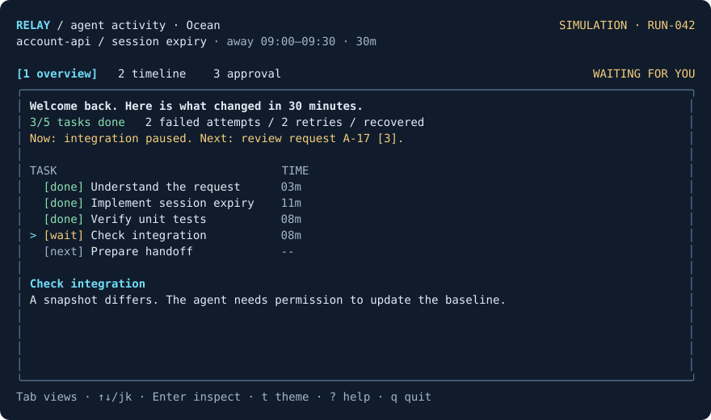

# Relay — agent activity, at a glance

A terminal activity monitor for AI coding work, built with **TypeScript + React + Ink**. Understand what happened, inspect failures, and review actions that need your decision.

**Status: early local release, with a Codex observation connector and demo mode.**
The connector receives project-local hook events; it must be configured and
trusted in Codex before events arrive. It does not automatically attach to every
desktop chat.

**Demo mode is simulated.** Live mode reads local metadata written by Codex hooks.
Relay never executes the agent's commands or approves its actions. It does not
store prompts, transcripts, command arguments, or code. Installing dependencies
requires internet access; live monitoring uses no network or API key.

## Run from source

Requires **Node.js 22 or later** and npm. Clone the repository and run:

```sh
git clone https://github.com/suyeet/Designing-a-terminal-ui.git
cd Designing-a-terminal-ui
npm ci
npm start
```

## Themes

Press **t** in demo or live mode to cycle through three themes:

| Theme | Appearance |
| --- | --- |
| Terminal | Uses your terminal background with familiar ANSI colors (default) |
| Ocean | Deep navy background, ice-blue accents, soft white text |
| Orchid | Deep plum background, lavender accents, warm white text |

```sh
npm start -- --theme=ocean
npm start -- --live --theme=orchid
relay --live --theme=ocean
```

Themes last for the current launch. Use `--theme` to choose one at startup.
Inside a confirmation dialog, `t` is text; it cannot change the theme or decision.
`NO_COLOR=1` removes colors and backgrounds while preserving all labels.
Ocean and Orchid look best in a terminal with true-color support. They color
Relay's content area, not the terminal application's title bar or preferences.



[Terminal preview](previews/terminal.svg) · [Orchid preview](previews/orchid.svg)

## Connect Codex


After building with `npm run build`, run from this checkout:

```sh
node dist/cli.js connect --project="/absolute/path/to/your/project"
node dist/cli.js --live --project="/absolute/path/to/your/project"
```

Or, after installing the terminal command, run these in the project you use with
Codex:

```sh
relay connect
relay --live
```

`connect` adds observation hooks to the project's `.codex/hooks.json`, preserving
other hooks and saving a backup when replacing an existing file. **Review and
trust the hooks in Codex**, then start or resume a local chat for that project.
An active chat may need to reload its hook configuration. The view waits for its
first event rather than inventing connection status.

Ask Codex to inspect a file. Watch for “New turn started” or “Tool started.”
Approval requests are informational: resolve them inside Codex. Use `[` and `]`
to switch observed sessions, arrows/j/k to select events, and `q` to quit.

The summary above the timeline counts tool starts, returns, explicit failures,
and approval requests for the selected session's latest observed turn. If its
turn-start record is missing, it is labeled **Recent activity** instead.
Counts describe retained observations: zero reported failures does not establish
success, and an approval request does not establish that a decision is pending.
Results and decisions still need to be checked in Codex.

See [connection and troubleshooting](docs/codex-connection.md) for the trust
requirement, limitations, and removal instructions.

## Install the terminal command

To build an installable package from this checkout:

```sh
npm ci
npm pack
npm install --global ./relay-agent-monitor-0.3.0.tgz
relay --demo
```

If you already have the packaged `.tgz` file, only the last two commands are needed.
The package includes compiled JavaScript; running the installed command does not
require TypeScript or the source checkout. Installing runtime dependencies needs
internet access unless they are already cached.

To remove the command:

```sh
npm uninstall --global relay-agent-monitor
```

Relay is not published to the npm registry yet. Install the local `.tgz` artifact;
do not assume an online package with a similar name is this project. `private`
remains enabled in the manifest to prevent accidental registry publication.

macOS has been tested locally. A GitHub Actions workflow is included to check
macOS and Linux with Node 22 and 24 when this repository is uploaded. Those hosted
checks have not run yet.

## Terminal size

Use a terminal at least **72 columns × 24 rows**. At 108 columns, the overview puts task details beside the task list. Smaller windows show a resize message and disable decisions. Default terminal backgrounds and `NO_COLOR=1` are supported; state labels remain readable without color.

## Try the scenario

1. You return at scenario time 09:30. Three of five tasks are complete. Two unit test failures have recovered; integration is waiting for a human decision.
2. Press `2` for the timeline. Press `f` to isolate failures, retries, and recovery. Use arrows or `j`/`k` to read each event.
3. Press `3` to review A-17: an integration snapshot update. Inspect the exact command, affected file, risk, and proposed diff.
4. Press `a` to review approval. Try Enter on its own: nothing changes. Escape cancels. To approve, type `APPROVE A-17` and press Enter.
5. Press `1`. Over about 3.2 seconds, integration passes and the handoff becomes ready for human code review.
6. Press `r`, type `RESET`, Enter. Now try `3`, `d`, type `DENY A-17`, Enter. The run stops and the baseline is preserved.

These are fictional results, not tests run against an actual account API. Approval never runs the displayed command. Restart creates a fresh demo; it does not undo an action in a real system.

## Keys

| Key | Action |
| --- | --- |
| `1` / `2` / `3` | Overview / timeline / approval |
| `Tab` / `Shift+Tab` | Next / previous view |
| `↑` / `↓` or `k` / `j` | Select task or event |
| `Enter` | Open approval from the integration task or request event |
| `f` | Toggle timeline filter |
| `a` / `d` | Begin approval / denial, only on the approval screen |
| Exact phrase + `Enter` | Confirm the current dialog |
| `Esc` | Cancel dialog, close help, or return to overview |
| `r` | Restart with `RESET` confirmation |
| `?` | Keyboard help |
| `t` | Cycle Terminal / Ocean / Orchid outside dialogs |
| `q` | Quit outside a confirmation dialog |
| `Ctrl+C` | Quit anywhere |

Confirmation dialogs own keyboard input: `q`, numbers, and shortcut letters are text there. Escape is always the cancel key. Pressing Enter twice does not approve.

## Commands

```sh
npm start                              # Interactive source version
npm run dev                            # Restart on source changes
npm run check                          # Type check + tests + build
npm run check:package                  # Test the installed package outside this folder
npm run build                          # Compile into dist/
npm run start:built                     # Run compiled JavaScript
npm run snapshot                       # Static overview, works without a TTY
npm run snapshot -- --view=timeline     # Static timeline
npm run snapshot -- --view=approval     # Static approval screen
npm start -- --help                     # CLI guide
NO_COLOR=1 npm start                    # No-color mode
```

Once installed, use `relay`, `relay --help`, `relay --version`, or
`relay --snapshot --view=approval`. `--demo` explicitly selects the same simulated
mode that starts by default.

When stdin or stdout is not a terminal, the CLI prints a static preview and exits. No input or raw mode is required. Snapshot size is fixed at 100×26 for repeatability. Use `relay --live --snapshot` to inspect the current local feed once.

## Project map

```text
src/model.ts             Typed scenario, decisions, transitions, event history
src/App.tsx              Ink views, keyboard routing, responsive layout
src/cli.tsx              Interactive entry point and static preview
src/LiveApp.tsx          Read-only Codex event view
src/live-summary.ts      Latest-turn summary from observed metadata
src/theme.tsx            Shared palettes and readable text colors
src/codex-events.ts      Metadata filtering and bounded local history
src/hook.ts              Codex hook receiver; returns no decisions
src/connect.ts           Preserve/merge project hook configuration
tests/model.test.ts      Safety and state transition tests
tests/ui.test.tsx        Keyboard flows and terminal layout checks
scripts/check-package.mjs  Pack, install, and exercise the shipped command
docs/design.md           Design assumptions and tradeoffs
docs/state-model.md      State model, transitions, and invariants
previews/                Plain-text captures of the actual renderer
```

The fixture is defined in `initialState()` in `src/model.ts`. Change task descriptions and timeline evidence there. The scenario clock is intentionally fixed; task durations are fixture values, not live elapsed time. After approval, a timer dispatches two deterministic simulation steps.

## Validation and limits

The test suite checks cancellation, mismatched phrases, repeated approvals, stale request IDs, denial remaining stopped, filtering, reset, keyboard flows, small-window interaction blocking, and essential content at 72/80/100/120 columns.

The demo has one fixed request and in-memory decisions. Live mode persists
minimal activity metadata and supports selecting observed sessions. It has no
task-plan extraction, changed-file viewer, agent control, or remote backend.
Observation coverage depends on Codex hooks and the installed runtime; it is not
a complete audit trail. A quiet feed does not prove the agent has stopped.

## Next product milestone

Local terminal Codex event delivery was verified on 21 October 2026 during a
file-read task and a checks task. Delivery from this desktop chat remains
unverified. The live view now summarizes the latest observed turn; try it during
small coding tasks and check whether it helps you regain context. Task-level progress and
changed-file evidence are later additions; live approval controls need a separate
enforced decision protocol. Demo mode stays available for exploring the interface.

Contributions are welcome; see [CONTRIBUTING.md](CONTRIBUTING.md). Licensed under
the [MIT license](LICENSE).

## Inspiration

Inspired by [Kaja Škerlj’s terminal UI case study](https://www.kajaskerlj.com/work/terminal-ui), especially the problem of regaining context during long agent runs. Relay’s scenario, interface, copy, and decision workflow are an independent experiment, not a recreation of *codeplain or an affiliated product.

Built using [Ink](https://github.com/vadimdemedes/ink). See [design assumptions](docs/design.md) and the [state model](docs/state-model.md).
