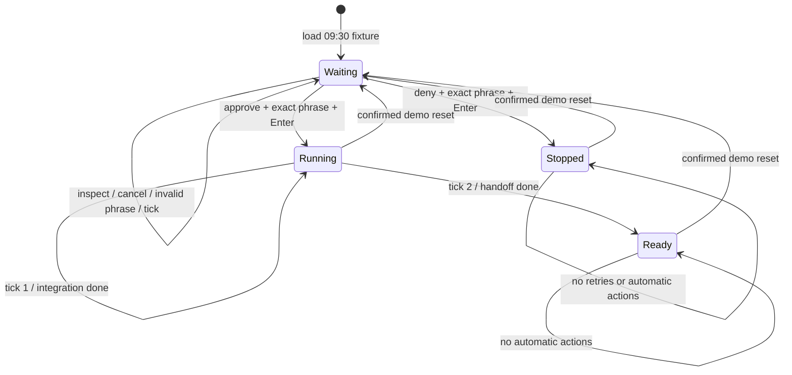

# State model

For demo mode, `src/model.ts` is the source of truth. A pure reducer owns domain and interface state. Components render this state and dispatch typed actions; they do not authorize by executing commands.

## Live summary

`src/live-summary.ts` derives counts from the selected session's retained feed.
It selects events from the most recent `UserPromptSubmit` or `SessionStart`
boundary in arrival order. Only a `UserPromptSubmit` boundary earns the label
"Latest turn"; otherwise the view says "Recent activity" because turn context
may be missing. No new events or state are persisted by this summary.

Tool starts and returns are counted separately without pairing by tool name.
Only explicit failed `PostToolUse` records count as reported failures. Later
returns do not prove recovery or erase those failures. Approval requests are
historical observations, not pending decisions. A new turn resets these summary
counts; previous turns remain in the timeline. Results remain unverified even
when a turn stops or no failures are recorded.

## Domain state

| Field | Values | Meaning |
| --- | --- | --- |
| `run` | waiting, running, ready, stopped | Whole-run state |
| `approval` | pending, approved, denied | Decision for A-17 |
| `tasks[].status` | done, waiting, queued, running, stopped | Task state |
| `step` | 0, 1, 2 | Deterministic post-approval simulation stage |
| `events` | Activity[] | Newest-first, append-by-prepending event history |

Every activity has an ID, scenario timestamp, kind, summary, and evidence detail. Failure events remain present after recovery. The immutable request fixture carries its ID, run ID, command, affected file, and scope. The displayed request is the same object referenced by the reducer.

## Interface state

`view` selects overview, timeline, or approval. `taskIndex` and `eventIndex` track selection separately. `failuresOnly` controls the timeline projection. `help` toggles the keyboard guide. `dialog` contains its intent, request binding, typed phrase, and validation message.

## Transitions

“Ready” means ready for human code review, not deployed or proven correct.

## Decision contract

1. The approval view must be open to begin a decision.
2. The request must still be pending.
3. A dialog captures intent and request ID; navigation is blocked.
4. Input must exactly match `APPROVE A-17` or `DENY A-17`.
5. On Enter, the reducer rechecks pending state and request ID.
6. The reducer records one decision event and consumes the pending request.
7. Approval allows simulated ticks; denial stops the run.

An empty, incorrect, or different-request phrase makes no domain change. Escape discards dialog text. Repeated confirmations cannot add duplicate decisions. Oversized or control-character input is filtered/bounded. If the terminal becomes too small, all decision input is disabled until context is visible again.

## Simulation clock

The scenario starts with activity from 09:00 to 09:30. Decisions are assigned 09:31; subsequent steps use 09:32 and 09:33. These are narrative times, independent of the user's local clock. By default, ticks occur every 1.6 seconds after approval. They do not occur while waiting or stopped.

The unit-test task has 2 failed attempts, 2 retries, and a successful third attempt. Integration has a separate snapshot mismatch requiring permission. This avoids equating a recovered failure with the current blocker.

## Production boundary

This reducer guards a local UI simulation. It is not an authorization service. A real agent must validate authorization outside the UI against immutable request content, identity, run, exact command/arguments, file scope, content hash, expiry, and current revision. It also needs durable audit events, duplicate-event handling, execution results, and recovery after disconnects. UI confirmation alone must never grant unrestricted shell access.
